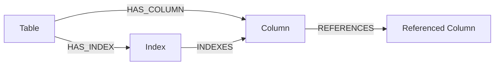

# Controlled Spider schema-retrieval experiment

This experiment compares the complete flat SQLite schema with a question-aware
graph context while keeping SQL generation and execution fixed. Neo4j stores
internal schema metadata. The user's input remains a natural-language question.
The implementation belongs to `feature/schema-graph`; it does not modify
Developer 5's evaluation harness or `scripts/run_eval.py`.

There are two explicit graph backends:

- `neo4j` uploads schema metadata and measures retrieval from a running Neo4j
  service, including its native join-path query. It requires a successful live
  connection and rejects any fallback.
- `local_graph` runs graph selection in memory as an offline diagnostic. Its
  results do **not** establish Neo4j service latency or model-answer gains.

Generation is disabled by default. Retrieval-only reports contain `null` SQL
execution/result-accuracy metrics, rendered as **TBD**, rather than mock or
replayed reference answers.

## Fixed dataset and gold-only selection

Use the locally provided Spider development split:

```text
data/spider_data/dev.json
data/spider_data/tables.json
data/spider_data/database/<db_id>/<db_id>.sqlite
```

The development file contains 1,034 questions. The tracked
[`eval/schema_spider_cases.json`](../eval/schema_spider_cases.json) records ten
cases with zero-based `source_index`, database ID, question, reference SQL,
required tables, qualified columns, and qualified foreign-key join edges.
SHA-256 fingerprints identify `dev.json`, `tables.json`, and each selected gold
SQL AST. The runner validates the annotations against those source files before
retrieval. Each output additionally records selected SQLite file fingerprints.
The full Spider dataset is not copied into the case fixture.

Selection occurs before retrieval or generation. It uses only Spider questions,
gold ASTs, and declared foreign keys in `tables.json`:

1. Keep queries with at least two distinct tables and an explicit, connected path
   of declared-FK equality joins. Exclude nested and set-operation queries so
   required paths have an unambiguous definition for this small experiment.
2. Deduplicate equivalent SQL text within each database. Eligible databases need
   at least two remaining queries, a 3+ table bridge query, and an aggregation
   query.
3. Rank databases by descending full-schema table count, then database ID. Take
   five databases and two queries per database. Within each, select the largest
   bridge query, preferring aggregation on ties, and the earliest distinct query
   that supplies aggregation if the bridge query did not.

The resulting fixture was selected without consulting retrieval output:

| Source indices | Database | Full-schema tables | Required tables per case | Coverage |
|---|---|---:|---|---|
| 535, 515 | `student_transcripts_tracking` | 11 | 3, 2 | Bridge; aggregation |
| 936, 930 | `dog_kennels` | 8 | 3, 2 | Bridge with aggregation; aggregation |
| 99, 89 | `car_1` | 6 | 4, 2 | Bridge; aggregation |
| 37, 22 | `concert_singer` | 4 | 3, 2 | Bridge; aggregation |
| 353, 307 | `cre_Doc_Template_Mgt` | 4 | 3, 2 | Bridge; aggregation |

This is a deliberately small join-focused sample, including larger schemas. It
is not the complete Spider evaluation or a representative random sample.

Regenerate the same reviewable fixture independently of retrieval:

```bash
python -m scripts.benchmark_schema_retrieval \
  --dataset-root data/spider_data \
  --select-only --case-count 10
```

## Controls and information boundaries

Both arms use the same natural-language question, per-case read-only SQLite
database, `top_k`, provider object, configured completion model, temperature, SQL
generator, syntax/safety checker, executor, and mechanical scorer. Only the
retrieved schema string changes at the generation boundary:

```text
question -> FlatSchemaRetriever.retrieve_with_metadata -> context A
question -> Neo4jSchemaRetriever.retrieve_with_metadata -> context B

question + context A/B -> src.agents.generate_sql(same provider)
  -> src.verifiers.check_syntax -> src.db.execute_sql -> result comparison
```

Gold annotations are used exclusively for scoring. Neither retriever receives
required table names, join edges, reference SQL, or expected results. The
provider receives only the question and the retrieved context. The reference
query is executed separately by the evaluator only when generation is enabled.
Known mock/oracle providers are rejected. A custom provider factory must make
actual model calls; a factory that replays gold SQL would invalidate the run.

Optimizer, semantic verifier, result verifier, and repair loops are excluded
from **both** arms to isolate schema retrieval. The shared syntax verifier and
executor enforce read-only SQL. No experiment query creates or changes SQLite
data. This experiment does not test the final orchestrator or response prose.

Each selected database is introspected and, for `neo4j`, uploaded exactly once
before measurement. Setup/upload latency is recorded separately. The measured
retrieval interval surrounds `retrieve_with_metadata`; model generation,
reference execution, generated SQL execution, and token counting are excluded.
Per-case and per-repetition order alternates flat/graph then graph/flat. Model
calls follow that case's first retrieval order. This mitigates systematic
warm-cache/order effects but does not provide a cold-cache benchmark.

Every arm records its actual context, backend, schema ID, qualified tables and
columns, FK relationships, all retrieval timing samples, and all repeated
contexts. An explicit stability flag reports whether repeats returned identical
metadata. Generation, when enabled, uses the first context and records generated
SQL, syntax status, rows, columns, timing, and errors.

## Metrics and interpretation

All retrieval rates are macro-averaged over the fixed cases:

- **Table/column recall:** fraction of gold-required names retrieved. Matching
  ignores case; columns are table-qualified.
- **Table/column precision:** fraction of retrieved names required by that gold
  query. Extra context is measured separately from omitted information.
- **Exact table set:** the returned table set equals the required set.
- **FK-edge recall/precision:** compare column-qualified, undirected edges.
  Direction is ignored because a SQL equality join can traverse either way.
- **Complete join-path coverage:** every required table and every required FK
  edge is present, including bridge edges.
- **Context size:** lexical words-and-punctuation estimate by default. It is
  explicitly marked an estimate, not the ASU model's tokenizer or billed usage.
  `--tokenizer-encoding` optionally counts a named `tiktoken` encoding; that
  encoding still need not match the configured completion model's tokenizer.
- **Retrieval latency:** mean/median wall time across all cases and repetitions;
  excluded setup latency remains available in the artifact.
- **Generation/syntax/execution success:** successful outcomes divided by all
  model-generation attempts in that arm. Failed generation or SQL counts as a
  failure rather than disappearing from the denominator.
- **Result accuracy:** correct generated-query results divided by all attempts.
  Reference results are compared through `src.score.results_equal` using
  positional column labels, preserving column count/order and row multiplicity
  while ignoring output alias spelling and row order. It retains the shared
  scorer's JSON value types, applies no floating-point tolerance, and does not
  verify requested result ordering.
  This is a mechanical result metric, not official Spider evaluation.

The complete flat schema is expected to have **100% required-table recall**.
That is useful completeness, not a failure. Graph retrieval is useful if it
reduces irrelevant context while retaining the required tables and join paths.
Retrieval quality alone cannot establish better generated SQL or lower total
latency; those require a measured generation run.

## Offline diagnostic recipe and observed snapshot

From an activated project environment:

```bash
python -m scripts.benchmark_schema_retrieval \
  --dataset-root data/spider_data \
  --backend local_graph --top-k 5 --repetitions 3 \
  --output eval/results/schema_spider_local_graph.json
```

The initial offline diagnostic on the fixed ten cases produced:

| Metric | Flat schema | Local graph diagnostic |
|---|---:|---:|
| Required table recall | 100.0% | 100.0% |
| Table precision | 45.8% | 85.8% |
| Exact table set | 0.0% | 60.0% |
| Required column recall | 100.0% | 100.0% |
| Column precision | 17.6% | 32.6% |
| Required FK-edge recall | 100.0% | 100.0% |
| FK-edge precision | 35.7% | 80.0% |
| Complete required join path | 100.0% | 100.0% |
| Mean lexical context estimate | 269.8 | 135.0 |
| Mean retrieval latency | 0.62 ms | 0.69 ms |
| SQL execution success | TBD: no model calls | TBD: no model calls |
| Result accuracy | TBD: no model calls | TBD: no model calls |

These latency values describe one local run and will vary. The smaller context
is an observed **offline diagnostic** result; no live Neo4j or model-answer
improvement is inferred. Full JSON/Markdown reports are generated under ignored
`eval/results/`; rerun the command to reproduce artifacts on the current code.

## Live Neo4j and ASU completion recipe

Install the optional schema driver and run a local Neo4j service, then configure
the ignored `.env` file. Keep secrets out of YAML and committed reports:

```bash
uv pip install --python .venv/bin/python -r requirements-schema.txt
```

```dotenv
SPIDER_DATA_ROOT=data/spider_data
NEO4J_URI=bolt://localhost:7687
NEO4J_USER=neo4j
NEO4J_PASSWORD=
NEO4J_DATABASE=neo4j
OPENCODE_BASE_URL=https://openai.rc.asu.edu/v1
OPENCODE_API_KEY=
COMPLETION_MODEL=openai/devstral2-123b
EMBEDDING_MODEL=openai/qwen3-embedding-4b
SQLITE_DB=data/spider_data/database/concert_singer/concert_singer.sqlite
```

Use plain URLs, with no Markdown link syntax or trailing backslashes. Set a
password of at least eight characters for a new local Neo4j instance; the username
is `neo4j`. With Docker running, the supplied configuration starts an isolated
local instance with persistent data and ports bound to localhost:

```bash
docker compose -f compose.neo4j.yaml up -d
```

Open `http://localhost:7474` to inspect it. A Neo4j Desktop instance can be used
instead: start that instance and use its existing password. Initial Docker
authentication is taken from `.env` only when its data volume is first created;
editing the variable does not reset an existing database's password. See the
[official Docker setup documentation](https://neo4j.com/docs/operations-manual/current/docker/introduction/).



Graph uploads use `MERGE` in a managed transaction and separate databases/schema
versions using a SHA-256 namespace. A new schema version does not delete the old
one. The live path query uses native `shortestPath` over `HAS_COLUMN|REFERENCES`
with a 32-edge cap and includes the owners of intermediate Column nodes. Equal
shortest paths can differ from the diagnostic's deterministic BFS path. Neo4j's
[transaction API](https://neo4j.com/docs/python-manual/current/transactions/) and
[shortest-path semantics](https://neo4j.com/docs/cypher-manual/current/patterns/shortest-paths/)
define the service behavior. The ASU adapter uses the
[Chat Completions request structure](https://developers.openai.com/api/reference/resources/chat/subresources/completions/methods/create)
with the supplied model, shared prompt, temperature zero and identical output
budget for both arms. No API key or connection password enters experiment reports.

The CLI explicitly loads `.env` without overriding existing environment values.
Library imports do not load credentials or open services. The configured
completion model remains the configured `openai/devstral2-123b`. ASU's live
`/models` listing advertises its API identifier as `devstral2-123b`; the adapter
removes the `openai/` routing prefix when sending a request. Reports retain both
the configured model and `request_model`, and both arms use the same values.
`EMBEDDING_MODEL` is reserved for
future retrieval work; this experiment uses deterministic lexical seed ranking
and FK paths, and does not call an embedding endpoint. `SQLITE_DB` is the
single-database setting; this runner chooses each case's Spider SQLite database
and does not change `SQLITE_DB`.

Measure actual Neo4j retrieval first, without model calls:

```bash
python -m scripts.benchmark_schema_retrieval \
  --backend neo4j --repetitions 3 \
  --output eval/results/schema_spider_neo4j_retrieval.json
```

Opt into twenty real completion calls, one per arm for each fixed question:

```bash
python -m scripts.benchmark_schema_retrieval \
  --backend neo4j --generate --temperature 0 \
  --output eval/results/schema_spider_neo4j_model.json
```

An unavailable Neo4j service aborts the strict run. It does not silently replace
Neo4j with a flat or local context. Real model errors remain failed attempts in
the generated metrics. An initial Docker Desktop disk-full failure aborted a
strict attempt before model generation. Docker recovered, and the live runs
described below completed on November 5, 2026, using local Neo4j and the ASU
completion endpoint.

## Measured live results

The paired model-backed run used the same ten fixed questions, three retrieval
repetitions per arm, and twenty real completion attempts: ten flat and ten
Neo4j. Both arms used configured model `openai/devstral2-123b`, request model
`devstral2-123b`, temperature zero, the same prompt, and the same output budget.
All five schemas uploaded successfully; every graph context came from the
`neo4j` backend, and all repeated contexts were stable. Gold SQL was not supplied
to the provider or replayed as its output, and the selection, retrieval algorithm, and scorer were not
changed after seeing the results.

Evidence from the same completed model-backed run:

- [JSON artifact](../eval/results/schema_spider_neo4j_model.json)
- [Generated paired Markdown report](../eval/results/schema_spider_neo4j_model.md)

These are local generated artifacts under ignored `eval/results/`; rerun the
live recipe above to recreate them in another checkout.

| Metric | Flat schema | Live Neo4j |
|---|---:|---:|
| Required table recall | 100.0% | 100.0% |
| Table precision | 45.8% | 85.8% |
| Exact required table set | 0.0% | 60.0% |
| Required column recall | 100.0% | 100.0% |
| Column precision | 17.6% | 32.6% |
| Required FK-edge recall | 100.0% | 100.0% |
| FK-edge precision | 35.7% | 80.0% |
| Complete required join path | 100.0% | 100.0% |
| Mean lexical context estimate | 269.8 | 135.0 |
| Mean retrieval latency | 1.57 ms | 35.61 ms |
| Median retrieval latency | 1.13 ms | 25.52 ms |
| SQL generation success | 7/10 (70%) | 8/10 (80%) |
| Syntax/safety success | 7/10 (70%) | 8/10 (80%) |
| Read-only execution success | 7/10 (70%) | 8/10 (80%) |
| Exact scored result accuracy | 6/10 (60%) | 6/10 (60%) |
| Mean successful SQL execution time | 0.477 ms | 0.481 ms |

Neo4j retained the required tables and joins while reducing the estimated
schema context by approximately 50.0% and increasing table precision. It
produced one more executable SQL answer in this run, but **did not improve the
declared result-accuracy metric**: both arms scored 6/10. Live Neo4j retrieval
was slower than flat SQLite introspection. This sample supports a context
selectivity benefit, not a result-accuracy or retrieval-speed advantage.

SQL execution timings are conditioned on successful executions, with seven
samples for flat and eight for Neo4j; the sub-millisecond difference does not
establish a speed improvement. No end-to-end pipeline latency, ASU tokenizer
usage, or billed model-token reduction was measured. One temperature-zero run
on ten chosen cases does not establish statistical significance.

The earlier live **retrieval-only** run measured 1.53 ms flat versus 58.88 ms
Neo4j mean retrieval latency, with the same recall, precision, and context-size
metrics. Its [JSON](../eval/results/schema_spider_neo4j_retrieval.json) and
[Markdown](../eval/results/schema_spider_neo4j_retrieval.md) remain separate
artifacts. Those timings are from a different run and are not substituted into
the paired model-backed table. Setup/uploads preceded measurement, so neither
run is a strict cold-cache benchmark.

### Error and mismatch audit

The saved errors show model-declared insufficient-schema refusals, represented
by `ValueError: The model reported insufficient schema to answer the question.`
There were no recorded HTTP, Neo4j retrieval, generated-SQL syntax, or SQL
execution errors in this run. Required-table/column/FK recall was complete, so
these refusals cannot be attributed to a measured omission by the retriever.

| Source index | Flat outcome | Neo4j outcome | Reference replay audit |
|---|---|---|---|
| 535 | Model refusal | Model refusal | Bachelor-program question; neither arm produced SQL. |
| 515 | Model refusal | Executed; scored mismatch | Neo4j returned department ID `8` and `statistics` in ID/name order; gold expects name/ID order. Values identify the same department, but the predeclared positional scorer counts the reversed output columns as incorrect. |
| 936 | Model refusal | Model refusal | Most-treatments owner question; neither arm produced SQL. |
| 22 | Executed; scored mismatch | Executed; scored mismatch | Both used a left join and returned nine stadiums, including four with zero concerts; gold uses an inner join and returns five stadiums. “Each stadium” admits a plausible broader interpretation, but the declared reference-result comparison remains false for both. |

The other six cases matched their reference result in both arms. The audit
replayed reference SQL locally without any additional model calls. It did not
change scores, remove difficult cases, reinterpret failed attempts as successes,
or claim that every reference mismatch demonstrates a semantic mistake by the
model.

For another actual provider, supply a factory returning the established
`SQLProvider.generate(question, schema_context) -> str` interface. The factory
must accept keyword arguments `model=None, temperature=0`; optional `model` and
`temperature` attributes are recorded and checked against controls:

```bash
python -m scripts.benchmark_schema_retrieval \
  --backend neo4j --generate \
  --provider-factory my_package.providers:create_provider \
  --model my-configured-model --temperature 0
```

The resulting paired Markdown table reports live retrieval, generation,
syntax/safety, execution, and result accuracy when available. The JSON artifact
contains the exact controls and per-case evidence needed to assess any gain.

## Public experiment interfaces

```python
from src.schema.spider_cases import load_cases, select_spider_cases
from src.schema.spider_experiment import run_schema_experiment, write_report

manifest = load_cases("eval/schema_spider_cases.json")
report = run_schema_experiment(
    "data/spider_data", manifest,
    backend="local_graph", top_k=5, repetitions=3,
)
json_path, markdown_path = write_report(
    report, "eval/results/schema_spider_local_graph.json"
)
```

`select_spider_cases(dataset_root, count=10)` produces the persisted gold-only
manifest. `run_schema_experiment` additionally accepts a shared `provider`,
`provider_name`, `model`, `temperature`, caller-owned Neo4j `driver`,
`neo4j_database`, and optional `tokenizer(text) -> int`. It returns
`manifest`, `case_manifest`, `graph_setup`, per-case `arms`, and paired `summary`.
`write_report` returns the JSON and Markdown paths. Existing retrievers retain
their string-returning `retrieve()` public interface; the experiment consumes
their additive `retrieve_with_metadata()` instrumentation.
